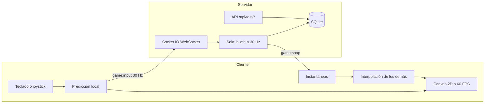

# CyberGrid Gato Royale

[](https://github.com/GatoGroZero/cybergrid-breach-sync/actions/workflows/ci.yml)

Battle royale multijugador de gatos en pixeles, en tiempo real. Doce gatos por partida (tú y hasta 11 más, los lugares libres los llenan bots) caen a un mapa con cofres, armas, casas y una **ola de agua** que se cierra por zonas. Gana el último gato en pie. Canvas 2D, WebSockets y servidor autoritativo.

|                      |                                                                                                     |
| -------------------- | --------------------------------------------------------------------------------------------------- |
| **URL pública**      | https://cybergrid-breach-sync.onrender.com                                                          |
| **Repositorio**      | https://github.com/GatoGroZero/cybergrid-breach-sync                                                |
| **Cuenta de prueba** | `demo1`, `demo2`, `demo3`, `demo4` con la contraseña `CyberGrid26` (o crea la tuya, no pide correo) |
| **Autor**            | GatoGroZero                                                                                         |

> El servicio corre en el plan gratuito de Render. Si lleva 15 minutos sin tráfico se duerme y la primera petición tarda cerca de un minuto en despertarlo. Hay un monitor que lo mantiene despierto, pero si lo encuentras lento, vuelve a intentar a los pocos segundos.

## Cómo evaluarlo en 4 pasos

Es la lista de comprobación del PDF de lineamientos, con lo que hay que hacer en cada punto.

1. **WebSockets activos.** Abre la URL, entra con `demo1` / `CyberGrid26` y pulsa **Jugar solo**. En DevTools, pestaña _Network_, filtro _WS_, abre la conexión `socket.io`: en _Messages_ se ven los eventos `ping` (enviado) y `pong` (recibido) cada segundo, y los `game:input` / `game:snap` de la partida. No hay peticiones `transport=polling`: el transporte es solo WebSocket. Arriba al centro del juego se ven los FPS y el RTT medido en vivo.
2. **Telemetría y latencia.**
   ```bash
   curl -s -w '\n%{time_total} s\n' https://cybergrid-breach-sync.onrender.com/api/test/telemetry
   ```
   Responde 200 con `winRate`, `kdr` y `survivability`. La cabecera `Server-Timing` y `meta.serverMs` dicen cuánto tardó el servidor en generarla (alrededor de 1 ms); el resto del tiempo es red.
3. **Pipeline.** En la pestaña [Actions](https://github.com/GatoGroZero/cybergrid-breach-sync/actions) y en la lista de commits de `main` se ve la palomita verde de cada merge (calidad, pruebas unitarias, compilación y E2E). Cada cambio entró por Pull Request.
4. **Móvil.** En Chrome: DevTools, _Toggle device toolbar_ (Ctrl+Shift+M), elige un teléfono en horizontal (por ejemplo Pixel 7) y recarga. Aparecen el joystick abajo a la izquierda y el botón FUEGO abajo a la derecha. En una PC con teclado esos controles se ocultan solos.

También se puede repetir todo con un solo comando, que mide TLS, los endpoints, el ping/pong y abre un móvil emulado:

```bash
node scripts/audit-prod.mjs https://cybergrid-breach-sync.onrender.com --browser
```

## Cumplimiento de los lineamientos

| Módulo (peso)                  | Qué se hizo                                                                                                                                                                                                                                                                                                       | Dónde está                                                                                            |
| ------------------------------ | ----------------------------------------------------------------------------------------------------------------------------------------------------------------------------------------------------------------------------------------------------------------------------------------------------------------- | ----------------------------------------------------------------------------------------------------- |
| **Red y sockets (25 %)**       | Servidor autoritativo con Socket.IO solo WebSocket. El cliente manda únicamente su intención (vector de movimiento, apuntado, disparo); posiciones, colisiones, inventario, daño y la ola se calculan en el servidor. Cada cliente recibe solo lo que tiene cerca. Eventos `ping` y `pong` propios.               | `src/server/br/Game.ts`, `src/server/lobby.ts`, `src/server/realtime.ts`                              |
| **Canvas y controles (25 %)**  | Bucle con delta time: paso fijo de simulación a 30 Hz con acumulador y dibujo limitado a 60 FPS en cualquier monitor (60, 120, 144 Hz). Teclado y ratón en PC; joystick virtual, botón de fuego abajo a la derecha, objetos e inventario dibujados en el canvas en pantallas táctiles, que cambian solos de modo. | `src/client/main.ts`, `src/client/game/render.ts`, `src/client/game/input.ts`, `src/shared/timing.ts` |
| **Endpoints de prueba (20 %)** | `GET /api/test/telemetry` y `POST /api/test/seed` (más `GET /api/test/health`). La telemetría se calcula con agregaciones SQL sobre tablas indexadas.                                                                                                                                                             | `src/server/testApi.ts`, `src/server/db.ts`                                                           |
| **Pruebas y CI/CD (15 %)**     | Pruebas unitarias y de integración (Vitest) y E2E (Playwright, los tres flujos del PDF más cofres, pintor y móvil). Pipeline en GitHub Actions en cada Pull Request y en cada push a `main`.                                                                                                                      | `tests/`, `.github/workflows/ci.yml`                                                                  |
| **Despliegue (15 %)**          | Render, región Ohio, TLS administrado por la plataforma, despliegue automático solo cuando pasa el CI (`autoDeployTrigger: checksPass`).                                                                                                                                                                          | `render.yaml`                                                                                         |

### Arquitectura



El mapa se genera con una semilla determinista que comparten cliente y servidor (solo viaja la semilla). El cliente predice su propio movimiento con la misma función que usa el servidor (`src/shared/br/physics.ts`), reconcilia con la instantánea que trae el último input procesado y dibuja a los demás con interpolación unos 90 ms en el pasado. El mundo se dibuja en un búfer de baja resolución (alto nativo de unos 270 px) y se escala con números enteros y sin suavizado, para que cada pixel del arte sea nítido. Todo el arte (gatos, árboles, casas, armas, cofres) se genera con código: no hay imágenes que descargar.

### Mediciones reales

Medidas el 24 de octubre de 2026 desde Jiutepec, Morelos, contra Render (Ohio) con `scripts/audit-prod.mjs`. La latencia depende de la distancia: Render no tiene región en México y el tráfico pasa por Cloudflare.

| Medición                                                                | Resultado                                        |
| ----------------------------------------------------------------------- | ------------------------------------------------ |
| Tiempo de proceso de la telemetría en el servidor                       | ~1 ms (consulta SQL ~0.7 ms, con 1 000 partidas) |
| `ping`/`pong` por WebSocket (40 muestras)                               | mediana entre 96 y 100 ms, mínimo ~85 ms         |
| `GET /api/test/telemetry` con conexión reutilizada                      | ~92 ms                                           |
| `GET /api/test/telemetry` con conexión nueva (DNS, TCP y TLS incluidos) | ~180 a 200 ms                                    |
| FPS del juego (Chromium, monitor de 60 Hz)                              | 60 (el dibujo tarda ~2 ms por cuadro)            |
| Instantáneas del servidor                                               | 30 por segundo                                   |
| CPU del servidor por partida de 12 gatos                                | ~0.1 ms por tick (hay 33 ms disponibles)         |

## Cómo se juega

- **Objetivo:** ser el último gato vivo. Empiezas con 100 de vida, 0 de escudo y solo con las garras.
- **Cofres:** son la única fuente de armas, balas, botiquines, escudos y mini muros. Los cofres dorados traen más y mejor. Al caer un gato deja una lápida con huella que se puede saquear.
- **Armas** (el daño es por rareza: gris, verde, morada con aura):

  | Arma     | Daño (gris / verde / morada) | Cómo dispara                               |
  | -------- | ---------------------------- | ------------------------------------------ |
  | Pistola  | 5 / 10 / 15                  | 1 bala por clic                            |
  | Escopeta | 10 / 20 / 30 por perdigón    | 2 cartuchos por disparo, varios perdigones |
  | Fusil    | 10 / 15 / 20                 | Ráfaga automática                          |
  | Sniper   | 40 / 70 / 80                 | 1 bala por clic, muy larga distancia       |
  | Bazuca   | 40 / 70 / 90                 | Misil con explosión en área                |

  Las pistolas son las más comunes; el fusil y la escopeta son raros; la sniper y la bazuca son lo más raro. Lo morado es difícil de encontrar.

- **Curación:** el botiquín da +10 de vida por segundo hasta 100 (caben 3 por casilla). Cada escudo da +10 por segundo durante 5 segundos, 50 en total, así que con dos se llena la barra (caben 4 por casilla). Si cambias de objeto a media curación se cancela y lo que faltaba se pierde.
- **Mini muros:** 150 de vida y se van rompiendo visualmente con cada golpe. Las garras también los rompen (25 por zarpazo), para que nadie se quede encerrado sin balas.
- **Inventario:** 5 espacios, abre con el botón de la lata de sardinas (o I). Arrastra para ordenar, suelta fuera para tirar. Los objetos del mismo tipo se apilan.
- **La ola** (la partida dura unos 2 minutos): 30 segundos de calma para buscar armas y municion. Al segundo 30 el aviso "La ola se cierra" y el agua llega a la primera zona en 10 segundos. Al 40 avisa que en 20 segundos se cierra la segunda, que tarda 15. Al 75 sale "Última ola cerrándose" con una cuenta de 10 segundos, y al 85 el agua se cierra hasta inundarlo todo. Las zonas son círculos al azar, cada vez más chicos. Fuera del círculo y dentro del agua se recibe daño.
- **Mapas** (hechos para 12 gatos): Bosque (casas con fachada, al menos 2 puertas e interior para saquear), Casa de gatitos (las casas son camas y los gatos se meten por debajo) y Piscina (el agua daña 5 cada medio segundo). Hay al menos 2 cofres y una caja de munición por jugador, en lugares distintos en cada partida, con minimapa y lugares con nombre (tecla M para verlo grande).
- **Cajas de munición:** cofres verdes que traen 4 clases de balas con cantidades grandes. Además, los cofres normales llevan más balas que antes y casi cada arma viene con las suyas.
- **Pelaje:** en el lobby pintas a tu gato (colores, pincel de 1 a 3, rayas, manchas) y así te ven los demás.
- **PC:** WASD o flechas para moverte, **Shift para correr**, ratón para apuntar, clic o espacio para disparar, E abre cofres, 1 a 5 eligen objeto, I inventario, M mapa, Esc menú. Todas las teclas se pueden cambiar en **Ajustes**.
- **Correr:** el gato galopa un 55 % más rápido y gasta la barra de estamina, que es un pez: se acaba en 5 segundos corriendo y se llena en 4 si estás quieto o caminando. Mientras corres no se recupera; si empiezas a correr a media recuperación, esta se detiene ahí. Sin aire no puedes correr hasta recuperar un poco.
- **Balas:** no ocupan los 5 espacios; viven en su propio compartimento (hasta 120 de cada arma) y se ven como "Balas de pistola", "Balas de fusil", etc. Arrástralas fuera del inventario para tirarlas.
- **Móvil:** se juega en horizontal (en vertical pide girar el teléfono). Joystick izquierdo para moverte (empújalo hasta el aro punteado para correr). **Joystick derecho para la mira:** al arrastrarlo aparece la línea de disparo y el arma dispara sola mientras la ves; al soltarlo deja de disparar. No hay auto apuntado. Con un muro en la mano la mira muestra en qué casilla caerá y se coloca al soltar (si lo regresas al centro se cancela); un toque corto usa botiquines y escudos. En **Ajustes** se puede mover y cambiar el tamaño de cada botón. Para jugar a pantalla completa en iPhone: Compartir, _Añadir a pantalla de inicio_; en Android se activa sola.
- **Ganar:** el último gato en pie se lleva una corona y la partida celebra con fuegos artificiales antes de mostrar los puestos.
- **Solo:** tú más 11 bots.
- **Emotes:** la tecla T (o el botón de la carita en el móvil) abre una barra con risa, llanto, enojo, bandera blanca y paz. Sale un globo sobre tu gato que ven los que están cerca. Hay un respiro de 1.5 segundos entre uno y otro, y con la barra abierta los números 1 a 5 eligen el emote.
- **Avisos:** el cuadro del objeto en mano (nombre y daño) se ve 2 segundos al cambiar de objeto y se difumina solo.
- **Salas:** cualquiera crea una sala con nombre, mapa y bots. Las públicas aparecen en la lista con su anfitrión, personas y bots, y la lista se actualiza sola. Las privadas se comparten con el código de 5 caracteres o con el enlace de invitación (`/?sala=ABCDE`).
- **Bots en la sala:** el anfitrión elige "Llenar con bots" (completa hasta 12 gatos) o una cantidad exacta de 0 a 11 (por ejemplo, 4 amigos y 8 bots). Con bots exactos se reserva su lugar: 8 bots dejan espacio para 4 personas. Sin bots hacen falta al menos 2 personas.
- **Ajustes e inicio:** solo el anfitrión cambia mapa, privacidad y bots (cada cambio quita el Listo a todos) y puede pulsar "Iniciar ya" sin esperar a que todos marquen Listo.

## API de prueba

```bash
# Métricas agregadas de las partidas
curl -s https://cybergrid-breach-sync.onrender.com/api/test/telemetry

# Inyecta 1 000 partidas de prueba, con 60 % de victorias
curl -s -X POST https://cybergrid-breach-sync.onrender.com/api/test/seed \
  -H 'Content-Type: application/json' -d '{"count": 1000, "winRate": 0.6}'
```

- `telemetry` devuelve `winRate` (partidas ganadas por un humano entre partidas jugadas), `kdr` (bajas entre muertes) y `survivability` (`survivalRate`: participaciones que terminaron en el podio, y `avgSurvivalSec`), además de la latencia reportada por los clientes y el estado del servidor. Con la base vacía devuelve ceros, nunca un error. Solo cuentan las personas, no los bots.
- `seed` acepta de 1 a 1 000 partidas (el rango oficial es de 100 a 1 000), con `count`, `seed`, `winRate`, `avgKills`, `avgDeaths`, `players` y `replace`. Un cuerpo vacío inserta 100. También entiende un arreglo de partidas, alias como `partidas` o `matches`, texto plano y formularios. Fuera de rango responde 400 con el detalle. Por defecto reemplaza lo sembrado antes, así que repetirlo da siempre el mismo resultado.
- `DELETE /api/test/seed` borra solo las partidas sembradas (las reales no se tocan) y deja la telemetría limpia.
- Son públicos a propósito porque el enunciado lo exige. Llevan límite de peticiones, tope de tamaño y de cantidad, y se pueden apagar con `ENABLE_TEST_ENDPOINTS=false`.

## Acceso

La pantalla de acceso ofrece solo lo que el servidor tiene activo (`GET /api/auth/config`):

| Forma de entrar       | Cómo funciona                                                                                                                                                                                                                 | Se activa con                                       |
| --------------------- | ----------------------------------------------------------------------------------------------------------------------------------------------------------------------------------------------------------------------------- | --------------------------------------------------- |
| **Google**            | Flujo de código en el servidor con PKCE, `state` y `nonce`. El navegador nunca ve el secreto ni el token; solo se pide `openid profile` (no se guarda el correo). La CSP no se abre a scripts de terceros.                    | `GOOGLE_CLIENT_ID` y `GOOGLE_CLIENT_SECRET`         |
| **Código por correo** | Llega un código de 6 números y se escribe en el juego. No guarda nada en el servidor: el desafío viaja en una cookie firmada con un HMAC del código, caduca en 10 minutos, sirve una vez y solo en el navegador que lo pidió. | `EMAIL_PROVIDER`, `EMAIL_API_KEY`, `EMAIL_FROM`     |
| **Invitado**          | Un clic, sin cuenta. La sesión se queda en el dispositivo.                                                                                                                                                                    | Activo por defecto (`GUEST_LOGIN=false` lo apaga)   |
| Usuario y contraseña  | Cuentas locales para pruebas y para la revisión. Va recogido en un desplegable.                                                                                                                                               | Activo por defecto (`PASSWORD_AUTH=false` lo apaga) |

**La cuenta no depende del disco.** El servidor gratuito de Render borra su disco al reiniciarse, así que una cuenta guardada solo en SQLite desaparecía al abrirla desde otro dispositivo. Ahora la identidad la pone el proveedor (el `sub` de Google, la huella del correo o un id de invitado), el id del jugador se calcula a partir de ella y la sesión es una cookie firmada: entrar con Google en otro dispositivo da el mismo jugador, y reiniciar el servidor no cierra sesiones. La primera vez en cada navegador se confirma el apodo (3 a 16 letras, números, guion bajo y espacios) y se puede cambiar tocando el nombre en el lobby.

**Correo sin SMTP.** Render bloquea los puertos SMTP (25, 465 y 587) en el plan gratuito, así que los códigos salen por la API HTTPS de [Resend](https://resend.com) o [Brevo](https://www.brevo.com). Para que lleguen a cualquier persona el remitente debe estar verificado (lo recomendable es un dominio propio). Sin esas variables la opción de correo simplemente no aparece.

**Configurar Google.** En [Google Cloud Console](https://console.cloud.google.com/apis/credentials) crea un "ID de cliente de OAuth" de tipo "Aplicación web" y agrega como URI de redireccionamiento autorizado `https://TU-DOMINIO/api/auth/google/callback`. Copia el ID y el secreto a `GOOGLE_CLIENT_ID` y `GOOGLE_CLIENT_SECRET`. La dirección pública sale de `PUBLIC_URL` o, en Render, de `RENDER_EXTERNAL_URL`.

## Seguridad

- Contraseñas con `scrypt` y sal propia; el tiempo de respuesta no distingue entre usuario inexistente y contraseña incorrecta.
- Google: `state` ligado a una cookie del navegador, `nonce` y PKCE (S256), el `id_token` se valida contra las llaves públicas de Google (emisor, audiencia, firma, vigencia y nonce) y el regreso usa la dirección configurada, nunca la cabecera `Host`.
- Código por correo: 6 números aleatorios, HMAC con el secreto del servidor, 5 intentos por código, un solo uso, 3 códigos por correo cada 10 minutos, 300 al día y tope por IP. La respuesta nunca dice si un correo existe ni lo devuelve.
- Todas las respuestas de acceso llevan `Cache-Control: no-store`, las peticiones exigen JSON y se rechazan los orígenes ajenos.
- Sesión en cookie `httpOnly`, `SameSite=Lax` y `Secure` en producción. El socket se autentica en el handshake: sin sesión no hay conexión ni salas.
- Límite de intentos de login, validación de todo lo que entra con Zod, cabeceras de Helmet y una política de contenido estricta (sin scripts ni estilos en línea).
- El servidor no confía en el cliente: recorta los vectores de movimiento, limita cuántos pasos puede avanzar un jugador por tick (contra aceleración), valida que el objeto exista en su inventario y su distancia al cofre, y descarta cualquier campo de más. Cada cliente solo recibe lo que está cerca de su gato.
- Las salas privadas no aparecen en la lista y exigen el código de 5 caracteres. Los ajustes (`room:settings`) y el inicio (`room:start`) solo los acepta el servidor si vienen del anfitrión, validados con Zod, y el cupo de personas lo calcula siempre el servidor.

## Pruebas

```bash
npm test            # pruebas unitarias y de integración
npm run test:cov    # con cobertura
npm run test:e2e    # E2E con Playwright (necesita npm run build antes)
```

| Área que pide el PDF                        | Archivo                                                          |
| ------------------------------------------- | ---------------------------------------------------------------- |
| Generador procedural de mapas               | `tests/unit/br-map.test.ts`                                      |
| Fórmulas de daño, escudo y escalado         | `tests/unit/br-combat.test.ts`, `tests/unit/br-items.test.ts`    |
| Esquemas Zod del payload                    | `tests/unit/schemas.test.ts`                                     |
| Interpolación de posiciones de jugadores    | `tests/unit/interp.test.ts`                                      |
| Bucle a 60 FPS por delta time               | `tests/unit/timing.test.ts`                                      |
| Física y colisiones                         | `tests/unit/br-physics.test.ts`                                  |
| Reglas de la partida, bots y autoridad      | `tests/unit/br-game.test.ts`                                     |
| Endpoints `/api/test/*` y rendimiento       | `tests/unit/api.test.ts`                                         |
| Autenticación y latencia ping/pong          | `tests/unit/auth-sockets.test.ts`                                |
| Lobbies y protección de salas               | `tests/unit/lobby.test.ts`, `tests/unit/rooms.test.ts`           |
| Acceso: Google, correo, invitado, apodo     | `tests/unit/auth-providers.test.ts`, `tests/unit/mailer.test.ts` |
| Geometría de los controles táctiles         | `tests/unit/controls.test.ts`                                    |
| E2E 1: autenticación y salas protegidas     | `tests/e2e/1-autenticacion.spec.ts`                              |
| E2E 2: lobbies, estado Listo y sockets      | `tests/e2e/2-lobby.spec.ts`                                      |
| E2E 6: acceso con Google, correo e invitado | `tests/e2e/6-acceso.spec.ts`                                     |
| E2E 3: canvas, controles y coordenadas      | `tests/e2e/3-canvas.spec.ts`                                     |
| E2E extra: cofres, inventario y pintor      | `tests/e2e/4-botin.spec.ts`                                      |
| E2E móvil: joystick táctil y giro           | `tests/e2e/movil.spec.ts`                                        |

## Correrlo en local

Requiere Node 22 o superior.

```bash
npm ci
npm run build
npm start            # http://localhost:3000 (entra como invitado, o con demo1 / CyberGrid26 en el desplegable)
```

Para desarrollar con recarga: `npm run dev:server` y, en otra terminal, `npm run dev:client` (http://localhost:5173). `npm run verify` corre revisión de texto, tipos, lint, pruebas y compilación. `npx tsx scripts/sim-br.ts 8 todos` simula partidas completas de bots para revisar el balance.

Variables de entorno: `PORT`, `SESSION_SECRET` (obligatoria en producción), `DB_PATH`, `ENABLE_TEST_ENDPOINTS`, `DEMO_ACCOUNTS`, `PASSWORD_AUTH`, `GUEST_LOGIN`, `SESSION_DAYS`, `PUBLIC_URL`, `GOOGLE_CLIENT_ID`, `GOOGLE_CLIENT_SECRET`, `EMAIL_PROVIDER` (`resend`, `brevo` o `console` solo fuera de producción), `EMAIL_API_KEY`, `EMAIL_FROM`, `EMAIL_FROM_NAME`, `TRUST_PROXY`, `COUNTDOWN_SECONDS` y `ZONE_TIME_SCALE` y `TEST_KIT` (solo para pruebas: acelera la ola, por ejemplo 40, y habilita los eventos `dev:kit` y `dev:finish`, que nunca funcionan con `NODE_ENV=production`). Si abres el juego con `?debug` en la URL, el navegador expone el estado local para las pruebas E2E.

## Estructura

```
src/shared   Lógica común y determinista: armas, botín, mapas, física, ola, esquemas Zod
src/server   Express, Socket.IO, simulación de la partida, bots, SQLite, endpoints de prueba
src/client   Canvas, arte en pixeles, entrada, predicción, HUD, inventario, pintor
tests        Unitarias e integración (Vitest) y E2E (Playwright)
scripts      Auditoría de producción, simulador de partidas, revisión de texto
```

## Notas de despliegue

El plan gratuito de Render no tiene disco persistente: la base SQLite se reinicia con cada despliegue o reinicio del servicio, y por eso las cuentas demo se vuelven a crear al arrancar. El plan gratuito tampoco garantiza CPU constante, así que el servidor simula a 30 Hz y no a 60.

Licencia MIT.
