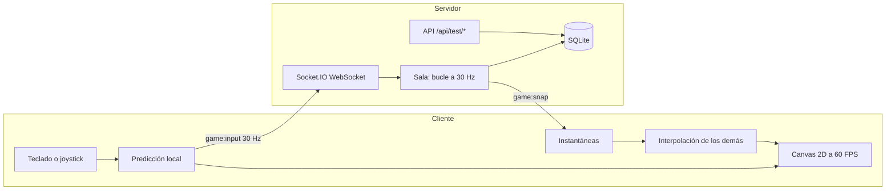

# CyberGrid Gato Royale

[](https://github.com/GatoGroZero/cybergrid-breach-sync/actions/workflows/ci.yml)

Battle royale multijugador de gatos en pixeles, en tiempo real. Diez gatos por partida (tú y hasta 9 más, los lugares libres los llenan bots) caen a un mapa con cofres, armas, casas y una **ola de agua** que se cierra por zonas. Gana el último gato en pie. Canvas 2D, WebSockets y servidor autoritativo.

|                      |                                                                                                     |
| -------------------- | --------------------------------------------------------------------------------------------------- |
| **URL pública**      | https://cybergrid-breach-sync.onrender.com                                                          |
| **Repositorio**      | https://github.com/GatoGroZero/cybergrid-breach-sync                                                |
| **Cuenta de prueba** | `demo1`, `demo2`, `demo3`, `demo4` con la contraseña `CyberGrid26` (o crea la tuya, no pide correo) |
| **Autor**            | GatoGroZero                                                                                         |

> El servicio corre en el plan gratuito de Render. Si lleva 15 minutos sin tráfico se duerme y la primera petición tarda cerca de un minuto en despertarlo. Hay un monitor que lo mantiene despierto, pero si lo encuentras lento, vuelve a intentar a los pocos segundos.

## Cómo evaluarlo en 4 pasos

Es la lista de comprobación del PDF de lineamientos, con lo que hay que hacer en cada punto.

1. **WebSockets activos.** Abre la URL, entra con `demo1` / `CyberGrid26` y pulsa **Jugar solo**. En DevTools, pestaña _Network_, filtro _WS_, abre la conexión `socket.io`: en _Messages_ se ven los eventos `ping` (enviado) y `pong` (recibido) cada segundo, y los `game:input` / `game:snap` de la partida. No hay peticiones `transport=polling`: el transporte es solo WebSocket. Arriba al centro del juego se ven los FPS y el RTT medido en vivo.
2. **Telemetría y latencia.**
   ```bash
   curl -s -w '\n%{time_total} s\n' https://cybergrid-breach-sync.onrender.com/api/test/telemetry
   ```
   Responde 200 con `winRate`, `kdr` y `survivability`. La cabecera `Server-Timing` y `meta.serverMs` dicen cuánto tardó el servidor en generarla (alrededor de 1 ms); el resto del tiempo es red.
3. **Pipeline.** En la pestaña [Actions](https://github.com/GatoGroZero/cybergrid-breach-sync/actions) y en la lista de commits de `main` se ve la palomita verde de cada merge (calidad, pruebas unitarias, compilación y E2E). Cada cambio entró por Pull Request.
4. **Móvil.** En Chrome: DevTools, _Toggle device toolbar_ (Ctrl+Shift+M), elige un teléfono en horizontal (por ejemplo Pixel 7) y recarga. Aparecen el joystick abajo a la izquierda y el botón FUEGO abajo a la derecha. En una PC con teclado esos controles se ocultan solos.

También se puede repetir todo con un solo comando, que mide TLS, los endpoints, el ping/pong y abre un móvil emulado:

```bash
node scripts/audit-prod.mjs https://cybergrid-breach-sync.onrender.com --browser
```

## Cumplimiento de los lineamientos

| Módulo (peso)                  | Qué se hizo                                                                                                                                                                                                                                                                                                       | Dónde está                                                                                            |
| ------------------------------ | ----------------------------------------------------------------------------------------------------------------------------------------------------------------------------------------------------------------------------------------------------------------------------------------------------------------- | ----------------------------------------------------------------------------------------------------- |
| **Red y sockets (25 %)**       | Servidor autoritativo con Socket.IO solo WebSocket. El cliente manda únicamente su intención (vector de movimiento, apuntado, disparo); posiciones, colisiones, inventario, daño y la ola se calculan en el servidor. Cada cliente recibe solo lo que tiene cerca. Eventos `ping` y `pong` propios.               | `src/server/br/Game.ts`, `src/server/lobby.ts`, `src/server/realtime.ts`                              |
| **Canvas y controles (25 %)**  | Bucle con delta time: paso fijo de simulación a 30 Hz con acumulador y dibujo limitado a 60 FPS en cualquier monitor (60, 120, 144 Hz). Teclado y ratón en PC; joystick virtual, botón de fuego abajo a la derecha, objetos e inventario dibujados en el canvas en pantallas táctiles, que cambian solos de modo. | `src/client/main.ts`, `src/client/game/render.ts`, `src/client/game/input.ts`, `src/shared/timing.ts` |
| **Endpoints de prueba (20 %)** | `GET /api/test/telemetry` y `POST /api/test/seed` (más `GET /api/test/health`). La telemetría se calcula con agregaciones SQL sobre tablas indexadas.                                                                                                                                                             | `src/server/testApi.ts`, `src/server/db.ts`                                                           |
| **Pruebas y CI/CD (15 %)**     | Pruebas unitarias y de integración (Vitest) y E2E (Playwright, los tres flujos del PDF más cofres, pintor y móvil). Pipeline en GitHub Actions en cada Pull Request y en cada push a `main`.                                                                                                                      | `tests/`, `.github/workflows/ci.yml`                                                                  |
| **Despliegue (15 %)**          | Render, región Ohio, TLS administrado por la plataforma, despliegue automático solo cuando pasa el CI (`autoDeployTrigger: checksPass`).                                                                                                                                                                          | `render.yaml`                                                                                         |

### Arquitectura



El mapa se genera con una semilla determinista que comparten cliente y servidor (solo viaja la semilla). El cliente predice su propio movimiento con la misma función que usa el servidor (`src/shared/br/physics.ts`), reconcilia con la instantánea que trae el último input procesado y dibuja a los demás con interpolación unos 90 ms en el pasado. El mundo se dibuja en un búfer de baja resolución (alto nativo de unos 270 px) y se escala con números enteros y sin suavizado, para que cada pixel del arte sea nítido. Todo el arte (gatos, árboles, casas, armas, cofres) se genera con código: no hay imágenes que descargar.

### Mediciones reales

Medidas el 24 de octubre de 2026 desde Jiutepec, Morelos, contra Render (Ohio) con `scripts/audit-prod.mjs`. La latencia depende de la distancia: Render no tiene región en México y el tráfico pasa por Cloudflare.

| Medición                                                                | Resultado                                        |
| ----------------------------------------------------------------------- | ------------------------------------------------ |
| Tiempo de proceso de la telemetría en el servidor                       | ~1 ms (consulta SQL ~0.7 ms, con 1 000 partidas) |
| `ping`/`pong` por WebSocket (40 muestras)                               | mediana entre 96 y 100 ms, mínimo ~85 ms         |
| `GET /api/test/telemetry` con conexión reutilizada                      | ~92 ms                                           |
| `GET /api/test/telemetry` con conexión nueva (DNS, TCP y TLS incluidos) | ~180 a 200 ms                                    |
| FPS del juego (Chromium, monitor de 60 Hz)                              | 60 (el dibujo tarda ~2 ms por cuadro)            |
| Instantáneas del servidor                                               | 30 por segundo                                   |
| CPU del servidor por partida de 10 gatos                                | ~0.1 ms por tick (hay 33 ms disponibles)         |

## Cómo se juega

- **Objetivo:** ser el último gato vivo. Empiezas con 100 de vida, 0 de escudo y solo con las garras.
- **Cofres:** son la única fuente de armas, balas, botiquines, escudos y mini muros. Los cofres dorados traen más y mejor. Al caer un gato deja una lápida con huella que se puede saquear.
- **Armas** (el daño es por rareza: gris, verde, morada con aura):

  | Arma     | Daño (gris / verde / morada) | Cómo dispara                               |
  | -------- | ---------------------------- | ------------------------------------------ |
  | Pistola  | 5 / 10 / 15                  | 1 bala por clic                            |
  | Escopeta | 10 / 20 / 30 por perdigón    | 2 cartuchos por disparo, varios perdigones |
  | Fusil    | 10 / 15 / 20                 | Ráfaga automática                          |
  | Sniper   | 40 / 70 / 80                 | 1 bala por clic, muy larga distancia       |
  | Bazuca   | 40 / 70 / 90                 | Misil con explosión en área                |

  Las pistolas son las más comunes; el fusil y la escopeta son raros; la sniper y la bazuca son lo más raro. Lo morado es difícil de encontrar.

- **Curación:** el botiquín da +10 de vida por segundo hasta 100 y el escudo +5 por segundo hasta 100. Si cambias de objeto a media curación se cancela.
- **Mini muros:** 150 de vida y se van rompiendo visualmente con cada golpe.
- **Inventario:** 5 espacios, abre con el botón de la lata de sardinas (o I). Arrastra para ordenar, suelta fuera para tirar. Los objetos del mismo tipo se apilan.
- **La ola:** durante los primeros 4 minutos no hay ola. A los 4, 8 y 12 minutos el agua avanza hacia una zona segura al azar (círculo) cada vez más chica, y desde el minuto 13:20 se cierra hasta no dejar zona libre. La partida dura máximo 15 minutos. Fuera del círculo y dentro del agua se recibe daño.
- **Mapas:** Bosque (casas con fachada, al menos 2 puertas e interior para saquear), Casa de gatitos (las casas son camas y los gatos se meten por debajo) y Piscina (el agua daña 5 cada medio segundo). Medianos, con minimapa y lugares con nombre (tecla M para verlo grande).
- **Pelaje:** en el lobby pintas a tu gato (colores, pincel de 1 a 3, rayas, manchas) y así te ven los demás.
- **PC:** WASD o flechas para moverte, ratón para apuntar, clic o espacio para disparar, E abre cofres, 1 a 5 eligen objeto, I inventario, M mapa, Esc menú. Todas las teclas se pueden cambiar en **Ajustes**.
- **Móvil:** se juega en horizontal (en vertical pide girar el teléfono). Joystick a la izquierda; FUEGO a la derecha (arrástralo para apuntar a mano; sin arrastrar, la ayuda de apuntado elige al gato más cercano). En **Ajustes** se puede mover y cambiar el tamaño de cada botón. Para jugar a pantalla completa en iPhone: Compartir, _Añadir a pantalla de inicio_; en Android se activa sola.
- **Solo:** tú más 9 bots. Con otras personas, la sala se llena a 10 con bots.

## API de prueba

```bash
# Métricas agregadas de las partidas
curl -s https://cybergrid-breach-sync.onrender.com/api/test/telemetry

# Inyecta 1 000 partidas de prueba, con 60 % de victorias
curl -s -X POST https://cybergrid-breach-sync.onrender.com/api/test/seed \
  -H 'Content-Type: application/json' -d '{"count": 1000, "winRate": 0.6}'
```

- `telemetry` devuelve `winRate` (partidas ganadas por un humano entre partidas jugadas), `kdr` (bajas entre muertes) y `survivability` (`survivalRate`: participaciones que terminaron en el podio, y `avgSurvivalSec`), además de la latencia reportada por los clientes y el estado del servidor. Con la base vacía devuelve ceros, nunca un error. Solo cuentan las personas, no los bots.
- `seed` acepta de 1 a 1 000 partidas (el rango oficial es de 100 a 1 000), con `count`, `seed`, `winRate`, `avgKills`, `avgDeaths`, `players` y `replace`. Un cuerpo vacío inserta 100. También entiende un arreglo de partidas, alias como `partidas` o `matches`, texto plano y formularios. Fuera de rango responde 400 con el detalle. Por defecto reemplaza lo sembrado antes, así que repetirlo da siempre el mismo resultado.
- `DELETE /api/test/seed` borra solo las partidas sembradas (las reales no se tocan) y deja la telemetría limpia.
- Son públicos a propósito porque el enunciado lo exige. Llevan límite de peticiones, tope de tamaño y de cantidad, y se pueden apagar con `ENABLE_TEST_ENDPOINTS=false`.

## Seguridad

- Contraseñas con `scrypt` y sal propia; el tiempo de respuesta no distingue entre usuario inexistente y contraseña incorrecta.
- Sesión en cookie `httpOnly`, `SameSite=Lax` y `Secure` en producción. El socket se autentica en el handshake: sin sesión no hay conexión ni salas.
- Límite de intentos de login, validación de todo lo que entra con Zod, cabeceras de Helmet y una política de contenido estricta (sin scripts ni estilos en línea).
- El servidor no confía en el cliente: recorta los vectores de movimiento, limita cuántos pasos puede avanzar un jugador por tick (contra aceleración), valida que el objeto exista en su inventario y su distancia al cofre, y descarta cualquier campo de más. Cada cliente solo recibe lo que está cerca de su gato.
- Las salas privadas no aparecen en la lista y exigen el código de 5 caracteres.

## Pruebas

```bash
npm test            # pruebas unitarias y de integración
npm run test:cov    # con cobertura
npm run test:e2e    # E2E con Playwright (necesita npm run build antes)
```

| Área que pide el PDF                     | Archivo                                                       |
| ---------------------------------------- | ------------------------------------------------------------- |
| Generador procedural de mapas            | `tests/unit/br-map.test.ts`                                   |
| Fórmulas de daño, escudo y escalado      | `tests/unit/br-combat.test.ts`, `tests/unit/br-items.test.ts` |
| Esquemas Zod del payload                 | `tests/unit/schemas.test.ts`                                  |
| Interpolación de posiciones de jugadores | `tests/unit/interp.test.ts`                                   |
| Bucle a 60 FPS por delta time            | `tests/unit/timing.test.ts`                                   |
| Física y colisiones                      | `tests/unit/br-physics.test.ts`                               |
| Reglas de la partida, bots y autoridad   | `tests/unit/br-game.test.ts`                                  |
| Endpoints `/api/test/*` y rendimiento    | `tests/unit/api.test.ts`                                      |
| Autenticación y latencia ping/pong       | `tests/unit/auth-sockets.test.ts`                             |
| Lobbies y protección de salas            | `tests/unit/lobby.test.ts`                                    |
| Geometría de los controles táctiles      | `tests/unit/controls.test.ts`                                 |
| E2E 1: autenticación y salas protegidas  | `tests/e2e/1-autenticacion.spec.ts`                           |
| E2E 2: lobbies, estado Listo y sockets   | `tests/e2e/2-lobby.spec.ts`                                   |
| E2E 3: canvas, controles y coordenadas   | `tests/e2e/3-canvas.spec.ts`                                  |
| E2E extra: cofres, inventario y pintor   | `tests/e2e/4-botin.spec.ts`                                   |
| E2E móvil: joystick táctil y giro        | `tests/e2e/movil.spec.ts`                                     |

## Correrlo en local

Requiere Node 22 o superior.

```bash
npm ci
npm run build
npm start            # http://localhost:3000, con las cuentas demo
```

Para desarrollar con recarga: `npm run dev:server` y, en otra terminal, `npm run dev:client` (http://localhost:5173). `npm run verify` corre revisión de texto, tipos, lint, pruebas y compilación. `npx tsx scripts/sim-br.ts 8 todos` simula partidas completas de bots para revisar el balance.

Variables de entorno: `PORT`, `SESSION_SECRET` (obligatoria en producción), `DB_PATH`, `ENABLE_TEST_ENDPOINTS`, `DEMO_ACCOUNTS`, `TRUST_PROXY`, `COUNTDOWN_SECONDS` y `ZONE_TIME_SCALE` (solo para pruebas: acelera la ola, por ejemplo 40). Si abres el juego con `?debug` en la URL, el navegador expone el estado local para las pruebas E2E.

## Estructura

```
src/shared   Lógica común y determinista: armas, botín, mapas, física, ola, esquemas Zod
src/server   Express, Socket.IO, simulación de la partida, bots, SQLite, endpoints de prueba
src/client   Canvas, arte en pixeles, entrada, predicción, HUD, inventario, pintor
tests        Unitarias e integración (Vitest) y E2E (Playwright)
scripts      Auditoría de producción, simulador de partidas, revisión de texto
```

## Notas de despliegue

El plan gratuito de Render no tiene disco persistente: la base SQLite se reinicia con cada despliegue o reinicio del servicio, y por eso las cuentas demo se vuelven a crear al arrancar. El plan gratuito tampoco garantiza CPU constante, así que el servidor simula a 30 Hz y no a 60.

Licencia MIT.
