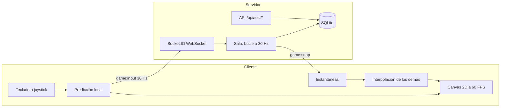

# CyberGrid: Breach & Sync

[](https://github.com/GatoGroZero/cybergrid-breach-sync/actions/workflows/ci.yml)

Videojuego web cooperativo en tiempo real. Hasta 4 jugadores infiltran una red generada por semilla, abren tres nodos (**Breach**) y luego sincronizan a todo el equipo en la salida (**Sync**) mientras los drones ICE los acorralan. Canvas 2D, WebSockets y servidor autoritativo.

|                      |                                                                                                     |
| -------------------- | --------------------------------------------------------------------------------------------------- |
| **URL pública**      | https://cybergrid-breach-sync.onrender.com                                                          |
| **Repositorio**      | https://github.com/GatoGroZero/cybergrid-breach-sync                                                |
| **Cuenta de prueba** | `demo1`, `demo2`, `demo3`, `demo4` con la contraseña `CyberGrid26` (o crea la tuya, no pide correo) |
| **Autor**            | GatoGroZero                                                                                         |

> El servicio corre en el plan gratuito de Render. Si lleva 15 minutos sin tráfico se duerme y la primera petición tarda cerca de un minuto en despertarlo. Hay un monitor que lo mantiene despierto, pero si lo encuentras lento, vuelve a intentar a los pocos segundos.

## Cómo evaluarlo en 4 pasos

Es la lista de comprobación del PDF de lineamientos, con lo que hay que hacer en cada punto.

1. **WebSockets activos.** Abre la URL, entra con `demo1` / `CyberGrid26` y pulsa **Jugar solo**. En DevTools, pestaña _Network_, filtro _WS_, abre la conexión `socket.io`: en _Messages_ se ven los eventos `ping` (enviado) y `pong` (recibido) cada segundo, y los `game:input` / `game:snap` de la partida. No hay peticiones `transport=polling`: el transporte es solo WebSocket. En la esquina superior izquierda del juego se ve el RTT medido en vivo.
2. **Telemetría y latencia.**
   ```bash
   curl -s -w '\n%{time_total} s\n' https://cybergrid-breach-sync.onrender.com/api/test/telemetry
   ```
   Responde 200 con `winRate`, `kdr` y `survivability`. La cabecera `Server-Timing` y `meta.serverMs` dicen cuánto tardó el servidor en generarla (alrededor de 1 ms); el resto del tiempo es red.
3. **Pipeline.** En la pestaña [Actions](https://github.com/GatoGroZero/cybergrid-breach-sync/actions) y en la lista de commits de `main` se ve la palomita verde de cada merge (calidad, pruebas unitarias, compilación y E2E). Cada cambio entró por Pull Request.
4. **Móvil.** En Chrome: DevTools, _Toggle device toolbar_ (Ctrl+Shift+M), elige un teléfono en horizontal (por ejemplo Pixel 7) y recarga. Aparecen el joystick abajo a la izquierda y el botón FUEGO abajo a la derecha. En una PC con teclado esos controles se ocultan solos.

También se puede repetir todo con un solo comando, que mide TLS, los endpoints, el ping/pong y abre un móvil emulado:

```bash
node scripts/audit-prod.mjs https://cybergrid-breach-sync.onrender.com --browser
```

## Cumplimiento de los lineamientos

| Módulo (peso)                  | Qué se hizo                                                                                                                                                                                                                                                                                                        | Dónde está                                                                                  |
| ------------------------------ | ------------------------------------------------------------------------------------------------------------------------------------------------------------------------------------------------------------------------------------------------------------------------------------------------------------------ | ------------------------------------------------------------------------------------------- |
| **Red y sockets (25 %)**       | Servidor autoritativo con Socket.IO solo WebSocket. El cliente manda únicamente su intención (vector de movimiento, disparo); posiciones, colisiones, inventario y daño se calculan en el servidor. Eventos `ping` y `pong` propios.                                                                               | `src/server/game/Game.ts`, `src/server/lobby.ts`, `src/server/realtime.ts`                  |
| **Canvas y controles (25 %)**  | Bucle con delta time: paso fijo de simulación a 30 Hz con acumulador, dibujo limitado a 60 FPS en cualquier monitor (60, 120, 144 Hz) y resolución dinámica si no se sostienen. Teclado y ratón en PC, joystick virtual y botón de acción dibujados en el canvas en pantallas táctiles, que cambian solos de modo. | `src/client/main.ts`, `src/client/render.ts`, `src/client/input.ts`, `src/shared/timing.ts` |
| **Endpoints de prueba (20 %)** | `GET /api/test/telemetry` y `POST /api/test/seed` (más `GET /api/test/health`). La telemetría se calcula con agregaciones SQL sobre tablas indexadas.                                                                                                                                                              | `src/server/testApi.ts`, `src/server/db.ts`                                                 |
| **Pruebas y CI/CD (15 %)**     | 75 pruebas unitarias y de integración (Vitest) y 12 E2E (Playwright, tres flujos más variantes). Pipeline en GitHub Actions en cada Pull Request y en cada push a `main`.                                                                                                                                          | `tests/`, `.github/workflows/ci.yml`                                                        |
| **Despliegue (15 %)**          | Render, región Ohio, TLS administrado por la plataforma, despliegue automático solo cuando pasa el CI (`autoDeployTrigger: checksPass`).                                                                                                                                                                           | `render.yaml`                                                                               |

### Arquitectura



El mapa se genera con una semilla determinista que comparten cliente y servidor (solo viaja la semilla). El cliente predice su propio movimiento con la misma función que usa el servidor (`src/shared/physics.ts`), reconcilia con la instantánea que trae el último input procesado y dibuja a los demás con interpolación unos 100 ms en el pasado.

### Mediciones reales

Medidas el 24 de octubre de 2026 desde Jiutepec, Morelos, contra Render (Ohio) con `scripts/audit-prod.mjs`. La latencia depende de la distancia: Render no tiene región en México y el tráfico pasa por Cloudflare.

| Medición                                                                | Resultado                                        |
| ----------------------------------------------------------------------- | ------------------------------------------------ |
| Tiempo de proceso de la telemetría en el servidor                       | ~1 ms (consulta SQL ~0.7 ms, con 1 000 partidas) |
| `ping`/`pong` por WebSocket (40 muestras)                               | mediana entre 96 y 100 ms, mínimo ~85 ms         |
| `GET /api/test/telemetry` con conexión reutilizada                      | ~92 ms                                           |
| `GET /api/test/telemetry` con conexión nueva (DNS, TCP y TLS incluidos) | ~180 a 200 ms                                    |
| FPS del juego (Chromium, monitor de 60 Hz)                              | 60                                               |
| Instantáneas del servidor                                               | 30 por segundo                                   |

## API de prueba

```bash
# Métricas agregadas de las partidas
curl -s https://cybergrid-breach-sync.onrender.com/api/test/telemetry

# Inyecta 1 000 partidas de prueba, con 60 % de victorias
curl -s -X POST https://cybergrid-breach-sync.onrender.com/api/test/seed \
  -H 'Content-Type: application/json' -d '{"count": 1000, "winRate": 0.6}'
```

- `telemetry` devuelve `winRate` (ganadas entre partidas), `kdr` (bajas entre muertes) y `survivability` (`survivalRate`: participaciones que terminaron vivas, y `avgSurvivalSec`), además de la latencia reportada por los clientes y el estado del servidor. Con la base vacía devuelve ceros, nunca un error.
- `seed` acepta de 1 a 1 000 partidas (el rango oficial es de 100 a 1 000), con `count`, `seed`, `winRate`, `avgKills`, `avgDeaths`, `players` y `replace`. Un cuerpo vacío inserta 100. También entiende un arreglo de partidas, alias como `partidas` o `matches`, texto plano y formularios. Fuera de rango responde 400 con el detalle. Por defecto reemplaza lo sembrado antes, así que repetirlo da siempre el mismo resultado.
- `DELETE /api/test/seed` borra solo las partidas sembradas (las reales no se tocan) y deja la telemetría limpia.
- Son públicos a propósito porque el enunciado lo exige. Llevan límite de peticiones, tope de tamaño y de cantidad, y se pueden apagar con `ENABLE_TEST_ENDPOINTS=false`.

## Seguridad

- Contraseñas con `scrypt` y sal propia; el tiempo de respuesta no distingue entre usuario inexistente y contraseña incorrecta.
- Sesión en cookie `httpOnly`, `SameSite=Lax` y `Secure` en producción. El socket se autentica en el handshake: sin sesión no hay conexión ni salas.
- Límite de intentos de login, validación de todo lo que entra con Zod, cabeceras de Helmet y una política de contenido estricta (sin scripts ni estilos en línea).
- El servidor no confía en el cliente: recorta los vectores de movimiento, limita cuántos pasos puede avanzar un jugador por tick, valida que tenga el objeto que quiere usar y descarta cualquier campo de más.
- Las salas privadas no aparecen en la lista y exigen el código de 5 caracteres.

## Pruebas

```bash
npm test            # 75 pruebas unitarias y de integración
npm run test:cov    # con cobertura
npm run test:e2e    # E2E con Playwright (necesita npm run build antes)
```

| Área que pide el PDF                       | Archivo                             |
| ------------------------------------------ | ----------------------------------- |
| Generador procedural de mapas              | `tests/unit/map.test.ts`            |
| Fórmulas de daño y escalado                | `tests/unit/formulas.test.ts`       |
| Esquemas Zod del payload                   | `tests/unit/schemas.test.ts`        |
| Interpolación de posiciones de jugadores   | `tests/unit/interp.test.ts`         |
| Bucle a 60 FPS por delta time              | `tests/unit/timing.test.ts`         |
| Endpoints `/api/test/*` y rendimiento      | `tests/unit/api.test.ts`            |
| Autenticación y latencia ping/pong         | `tests/unit/auth-sockets.test.ts`   |
| Autoridad del servidor y reglas de partida | `tests/unit/game.test.ts`           |
| Lobbies y protección de salas              | `tests/unit/lobby.test.ts`          |
| E2E 1: autenticación                       | `tests/e2e/1-autenticacion.spec.ts` |
| E2E 2: lobbies, estado Listo y sockets     | `tests/e2e/2-lobby.spec.ts`         |
| E2E 3: canvas, controles y coordenadas     | `tests/e2e/3-canvas.spec.ts`        |
| E2E móvil: joystick táctil y giro          | `tests/e2e/movil.spec.ts`           |
| Geometría de los controles táctiles        | `tests/unit/controls.test.ts`       |

## Correrlo en local

Requiere Node 22 o superior.

```bash
npm ci
npm run build
npm start            # http://localhost:3000, con las cuentas demo
```

Para desarrollar con recarga: `npm run dev:server` y, en otra terminal, `npm run dev:client` (http://localhost:5173). `npm run verify` corre revisión de texto, tipos, lint, pruebas y compilación.

Variables de entorno: `PORT`, `SESSION_SECRET` (obligatoria en producción), `DB_PATH`, `ENABLE_TEST_ENDPOINTS`, `DEMO_ACCOUNTS`, `TRUST_PROXY`, `COUNTDOWN_SECONDS`.

## Cómo se juega

- **PC:** WASD o flechas para moverte, ratón para apuntar, clic o espacio para disparar, teclas 1 a 3 para usar objetos, M para silenciar.
- **Móvil:** se juega en horizontal (en vertical pide girar el teléfono). El joystick es flotante: apoya el pulgar en la mitad izquierda; abajo a la derecha están FUEGO y, en arco a su alrededor, los tres objetos. El disparo apunta solo al dron más cercano y el teléfono vibra al recibir daño. Para jugar a pantalla completa en iPhone: Compartir, _Añadir a pantalla de inicio_; en Android la pantalla completa se activa sola.
- **Objetivo:** pónganse sobre cada nodo hasta abrirlo. Si hay drones encima, el nodo queda **disputado** y la captura se detiene hasta despejarlos. Con los tres abiertos aparece la salida: todos los jugadores vivos deben estar dentro a la vez para sincronizar. Si caes, reapareces dos veces más (con un pulso que aturde a los drones cercanos).
- **Objetos:** parche (cura), overclock (velocidad) y EMP (aturde y daña en área).

## Estructura

```
src/shared   Lógica común y determinista: mapa, física, fórmulas, interpolación, Zod
src/server   Express, Socket.IO, simulación de la partida, SQLite, endpoints de prueba
src/client   Canvas, entrada, predicción, interfaz
tests        Unitarias e integración (Vitest) y E2E (Playwright)
scripts      Auditoría de producción, bot de balance, revisión de texto
```

## Notas de despliegue

El plan gratuito de Render no tiene disco persistente: la base SQLite se reinicia con cada despliegue o reinicio del servicio, y por eso las cuentas demo se vuelven a crear al arrancar. El plan gratuito tampoco garantiza CPU constante, así que el servidor simula a 30 Hz y no a 60.

Licencia MIT.
